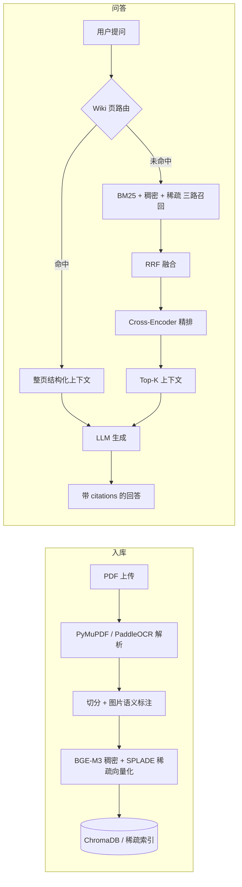

# Enterprise Knowledge Base RAG

基于 FastAPI 的企业知识库问答系统。上传 PDF 后自动解析、切分、向量化，用户用自然语言提问，系统检索相关条款并生成**带引用**的回答。

针对「制度条款」这类高度结构化的语料，采用 **Wiki 页优先 + 切片级 RAG 兜底** 的两级结构，并用 RAGAS 做量化评测。

---

## 核心能力

| 能力 | 说明 |
|---|---|
| 混合检索 | BM25 + BGE-M3 稠密 + SPLADE 稀疏三路并行召回，RRF 融合后 Cross-Encoder 精排 |
| 两级知识结构 | 制度页命中直接返回整页；未命中降级到切片级 RAG |
| 多模态解析 | PyMuPDF 文本层 + PaddleOCR 扫描件，双通道覆盖纯扫描 PDF |
| 多租户隔离 | 每租户独立上传目录与向量库，API 全链路按 `tenant_id` 过滤 |
| 角色权限 | 四角色 RBAC，首个用户为 super_admin，文档删除仅管理员可用 |
| 三层记忆 | 短期（Redis 2h）+ 中期（摘要 24h）+ 长期（ChromaDB） |
| 流式输出 | SSE 实时返回，前端逐字渲染 |
| 知识审定 | 页面级与切片级 draft/approved 双层审核，审定记录入审计表 |
| 成本与稳定性 | Redis 语义缓存、限流、LLM 多供应商 fallback、Token 预算上限 |
| 全链路追踪 | 每步耗时、Token 统计、检索命中与降级原因可回放 |

## 技术栈

`Python` `FastAPI` `ChromaDB` `Redis` `SQLite` `BGE-M3` `BM25` `SPLADE` `RRF` `Cross-Encoder` `PaddleOCR 3.7` `PyMuPDF` `RAGAS` `SSE` `Docker Compose`

---

## 架构



---

## 技术亮点

**1. 三路混合召回 + RRF 融合**
BM25 补精确匹配（条款编号、专有名词），BGE-M3 稠密补语义，SPLADE 稀疏补领域术语。三路并行召回后 RRF 融合、Cross-Encoder 精排，避免单一通道的召回盲区。

**2. Wiki 页优先的两级知识结构**
制度条款是高度结构化的：一条规则往往跨多个小节，按切片召回容易只捞到「附录」「工单字段」这类噪音。因此在混合检索前置一层页面路由——别名与小节标题确定性匹配，命中直接返回整页；未命中才降级到切片级 RAG。

**3. 检索质量治理**
页面与切片双层 `draft/approved` 审定，稠密过滤 + 稀疏语料剔除；低置信不硬答，转兜底或转人工；所有答案带 `citations` 溯源到具体文档与页码。

**4. OCR 与内存控制**
扫描件走 PaddleOCR 3.7，双栏重排后回填；入库按批向量化、FP16 权重、OCR 中间图逐页释放，避免整本 PDF 常驻内存。

---

## 评测结果

### RAGAS 四维（25 题金标集）

| 配置 | 忠实度 | 上下文精确率 | 上下文召回率 | 答案相关性 |
|---|---|---|---|---|
| 纯稠密 | 0.943 | 0.871 | 0.92 | 持平 |
| + BM25 | 0.971 | 0.898 | 0.92 | 持平 |
| **三路混合** | **1.000** | **0.898** | **0.92** | 持平 |

稀疏通道主要补的是**上下文精确率**，不是召回率——这个结论来自消融，不是猜测。

### Wiki 路由 vs 纯 RAG（同一批问题）

| 指标 | Wiki 优先 | 纯 RAG |
|---|---|---|
| 金标证据覆盖（审定后 6 题） | **6/6** | 4/6 |
| 平均上下文长度 | 781 字 | 1100 字 |
| 平均上下文构建耗时 | **266 ms** | 890 ms |

> 样本量 6 条只能看趋势，不作结论。无外网环境时 Reranker 降级跳过，纯 RAG 的真实水平应略好于表中数字。

---

## 快速开始

```bash
# macOS 一键启动（含 Redis + OCR 环境）
./start-mac.sh

# 停止
./stop-mac.sh
```

或手动启动：

```bash
pip install -r requirements-docker.txt
python -m uvicorn app.main:app --reload --host 0.0.0.0 --port 8000
```

启动后访问 `http://localhost:8000`，注册的首个用户自动成为 `super_admin`。

### Docker

```bash
docker compose up -d --build
```

容器：`app`（FastAPI，8000）、`redis`（6379）。

---

## API 概览

| 方法 | 路径 | 说明 |
|---|---|---|
| POST | `/api/auth/register` `/api/auth/login` | 注册 / 登录，返回 Token |
| POST | `/api/documents/upload` | 上传 PDF，异步索引 |
| GET | `/api/documents` | 租户内文档列表 |
| DELETE | `/api/documents/{id}` | 删除文档并清理向量库（管理员） |
| POST | `/api/chat` | 问答，支持 SSE 流式 |
| GET | `/api/wiki/pages` | 制度页列表与审定状态 |
| POST | `/api/wiki/pages/{id}/review` | 页面审定（draft → approved） |
| GET | `/health` | 健康检查 |

---

## 目录结构

```
app/
├── api/          # REST 接口：auth / documents / chat / wiki / category
├── ingestion/    # PDF 解析、OCR、图片语义标注
├── processing/   # 多模态管道、分块、元数据
├── retrieval/    # BM25 / 稠密 / 稀疏召回、RRF、精排、缓存、查询改写
├── wiki/         # 两级知识结构：页面路由与审定闭环
├── evaluation/   # RAGAS 评测、A/B 实验、golden set 生成
├── tenant/       # 多租户隔离与会话
├── memory/       # 三层记忆
├── core/         # 配置、日志、Trace
└── main.py       # 应用入口
docs/             # 设计决策、踩坑记录、更新日志
start-mac.sh / stop-mac.sh
```

运行时数据（`chroma_db/`、`sparse_db/`、`uploads/`、`model_cache/`）均不入库。

---

## 能力边界

**已实现**：多租户隔离、四角色 RBAC、文档与审定审计、知识草稿/审核/灰度/回滚、限流与语义缓存、全链路 Trace、RAGAS 回归评测。

**尚未覆盖**：多实例共享向量存储、完整监控告警接入、在线 A/B 全自动化、真实企业审批流对接。

本项目为本地可运行的完整演示系统，未接入企业生产环境。

---

## 更多文档

| 文档 | 内容 |
|---|---|
| [docs/DESIGN.md](docs/DESIGN.md) | 模型选型、OCR 接入、高并发优化、两级知识结构、测试体系 |
| [docs/TROUBLESHOOTING.md](docs/TROUBLESHOOTING.md) | 18 条真实踩坑与修复记录 |
| [docs/FAQ.md](docs/FAQ.md) | 常见技术问题（检索、分块、评测口径） |
| [docs/CHANGELOG.md](docs/CHANGELOG.md) | 完整更新日志 |
| [docs/ARCHIVE-README.md](docs/ARCHIVE-README.md) | 重构前的完整 README 存档 |
